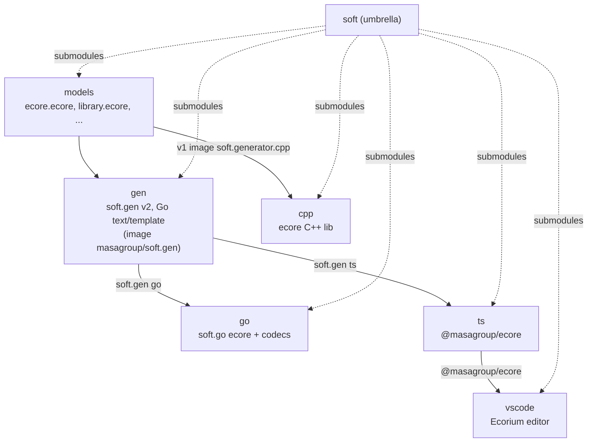
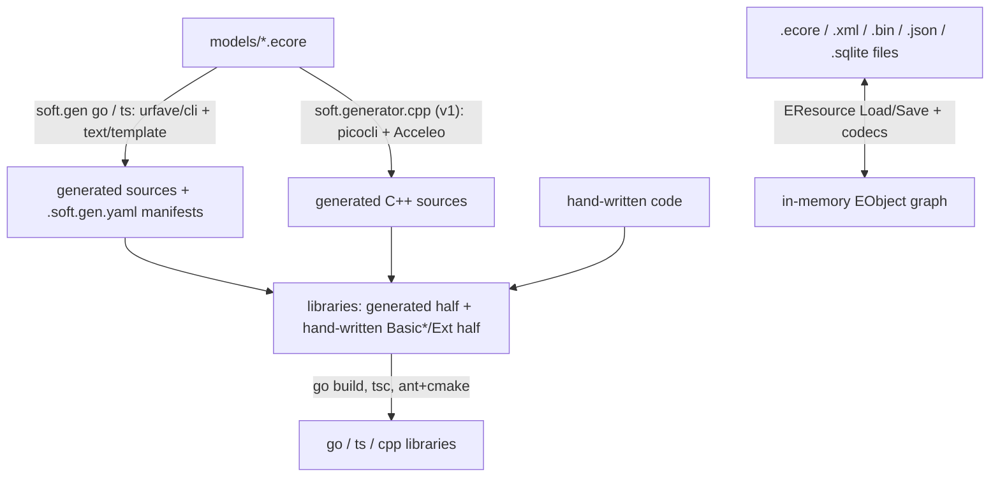
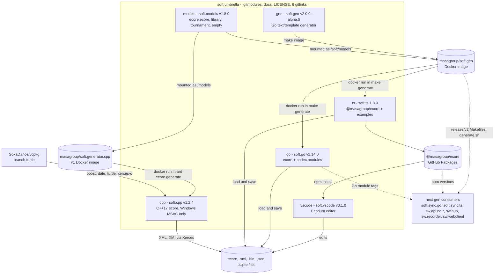
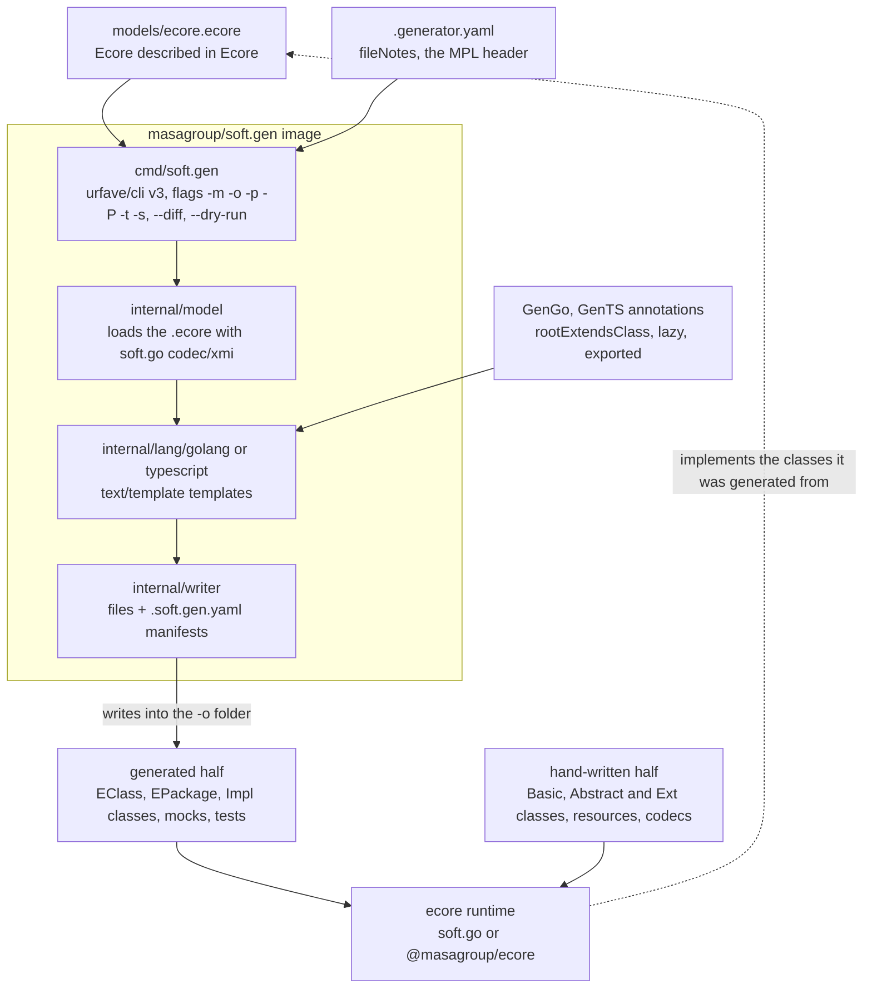
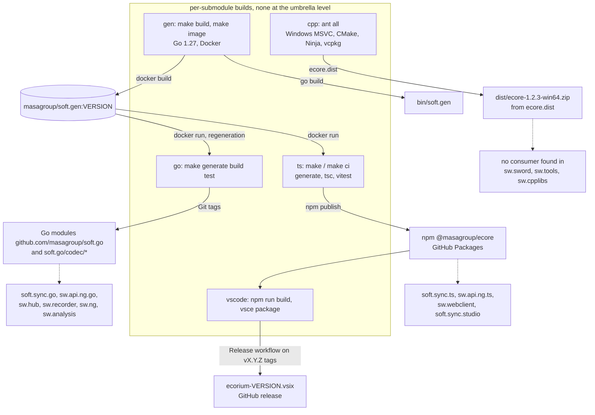

# soft: architecture

> Technical choices, diagrams and internal structure of `soft`. Back to the [README](README.md) · [Contributing](CONTRIBUTING.md) · [repository on GitHub](https://github.com/masagroup/soft)

| | |
|---|---|
| **Family** | Ecore / esync |
| **Kind** | build tooling (umbrella of git submodules: ecore model, Go / TypeScript / C++ libraries, generator, editor) |
| **Languages** | Umbrella itself: none. Submodules: Go (`gen`, `go`), TypeScript (`ts`, `vscode`), C++17 (`cpp`), Ecore XMI models (`models`) |
| **Remote / branch** | github.com/masagroup/soft, default branch `master` |
| **Generation** | shared (foundation of the generated ecore model code) |
| **Build systems** | none at the umbrella level · per submodule: Make + Go + Docker (`gen`, `go`) · Make + npm + Docker (`ts`) · npm + esbuild (`vscode`) · Ant + CMake/Ninja (`cpp`, Windows/MSVC only) |

## Overview

The repository in its ecosystem (the submodules are listed in the [README](README.md#submodules)):



## Position in the ecosystem

| Concept | Verdict | Evidence |
|---|---|---|
| ecore model | Implements: Ecore runtime in Go/TS/C++, Ecore codecs, the generator producing typed model code from `.ecore`, an `.ecore` editor | `go/ecore`, `go/codec`, `ts/ecore/src`, `cpp/ecore/lib`, `gen/internal`, `models/ecore.ecore`, `vscode/src` |
| esync (model synchronisation) | Not in this repo. The building blocks are here (notifications, `EContentAdapter`, `EStore`, binary codecs); esync itself is in `soft.sync.go` and `soft.sync.ts`, which are not submodules; see the ecosystem wiki page [esync and ecore](https://github.com/masagroup/wiki/wiki/esync-ecore) | no `esync` code in the submodules |
| gateway, history, dos, storage, authentication, node, orchestrator, commander, hub, recorder, timeline, mapserver, webclient, datacore, dispatcher | Unrelated | no reference found |
| HLA | Unrelated | no reference |
| Consumers of generated model code | soft.sync.go, sw.api.ng.go, sw.recorder, sw.hub and the other NG Go services consume `soft.go`; soft.sync.ts, sw.api.ng.ts, sw.webclient and soft.sync.studio consume `@masagroup/ecore`; the `release/v2` branches of soft.sync.go and sw.api.ng.go run the `masagroup/soft.gen` image | their `go.mod`, `package.json`, Makefiles (see the soft.go and soft.gen READMEs) |

Practical implications derived from the code:

- Language support is uneven: Go is the richest (XML, XMI, binary, JSON, SQLite codecs as separate modules, SQLite-backed `EStore`); TypeScript has XML, XMI and binary codecs; C++ is Windows/MSVC only and still on its 2021 version.
- C++ is not ported to soft.gen v2: `cpp` still depends on the v1 Java / Acceleo image `masagroup/soft.generator.cpp`, the last consumer of the v1 generators in this umbrella.
- Any repository that regenerates models depends on the Docker image `masagroup/soft.gen` at a pinned version (`SOFT_GEN_VERSION`); its supply chain therefore matters.
- For the Windows -> Linux port, `soft.cpp` is a blocker candidate: MSVC-only compile flags, Windows-only Ant bootstrap, no Dockerfile, no `packages-latest` image.
- Transverse context: the ecosystem wiki pages [Next-generation ecosystem](https://github.com/masagroup/wiki/wiki/ecosystem-nextgen), [esync and ecore](https://github.com/masagroup/wiki/wiki/esync-ecore) and [Glossary](https://github.com/masagroup/wiki/wiki/glossary).

## Repository layout

```
soft/
  .gitmodules  README.md  ARCHITECTURE.md  CONTRIBUTING.md  README.LEGACY.md  LICENSE
  gen/      Go generator soft.gen v2: cmd/soft.gen, internal/{engine,lang/{common,golang,typescript},model,naming,props,tmpl,writer}, testdata/{models,golden}, Makefile, Dockerfile, version.sh
  go/       Go ecore library: ecore/ (package ecore), codec/{xml,xmi,binary,json,sqlite,defaults} (one module each), test/{empty,library,tournament,integration}, go.work, Makefile, .generator.yaml
  ts/       TypeScript ecore library: ecore/ (@masagroup/ecore), examples/{library,empty,tournament,inheritance,coexistence}, Makefile, .generator.yaml
  cpp/      C++17 ecore library: ecore/{lib,tests}, library/{lib,tests}, build.xml (Ant), build.properties, generator.properties
  models/   ecore.ecore (Ecore described in Ecore), library.ecore, tournament.ecore, empty.ecore, Eclipse launch configs (v1 generators)
  vscode/   Ecorium VS Code extension: src/, media/, samples/, test/, esbuild.mjs, package.json
```

Tracked files in the umbrella (`git ls-tree HEAD`): `.gitmodules`, `LICENSE`, the four documentation files and the six gitlinks.

## Architecture

### Generation concept and data flow



The libraries themselves do no network I/O; resource I/O goes through `EURIConverter` / `EURIHandler` (file; Go also `memory`).

What is committed: Go and TypeScript commit both halves of the `ecore` package (generated and hand-written); the generated code of the Go test models (`go/test/{empty,library,tournament}`) and of the TypeScript examples is git-ignored, so those compile only after `make generate` (Go) or `make <example>.generate` (TS). In C++ only the hand-written half is tracked.

Annotations in the `.ecore` file steer each backend, for example `GenGo` `rootExtendsClass=ecore.CompactEObjectContainer`, `lazy=list:function`, `exported=true` on the Ecore package; `GenCpp` `factory=extension`. soft.gen v2 reads the same annotation keys and properties as v1.

### Core library API (consistent across the three languages)

- Object model: `EObject`, `EClass`, `EClassifier`, `EAttribute`, `EReference`, `EOperation`, `EPackage`, `EFactory`, `EEnum`, `EDataType`, `EAnnotation`, `EGenericType`; dynamic objects and a reflective API.
- Collections: `EList`, `EMap`, `ENotifyingList`, `EObjectList`, `BasicEList`, `ImmutableEList`, `BasicEMap`, `BasicEObjectMap` (Go/TS), `ECollectionView` and `Lazy` (C++).
- Notifications: `ENotifier`, `ENotification`, `ENotificationChain`, `EAdapter` / `AbstractEAdapter`, `EContentAdapter` (change tracking over containment trees). No synchronisation code lives in this repository.
- Resources: `EResource`, `EResourceSet`, `EURIConverter`, `EURIHandler`, `EPackageRegistry`, codecs and codec registries, `EObjectIDManager` (Go: `UniqueIDManager`, `ULIDManager`, `UUIDManager`, `IncrementalIDManager`; TS: `UniqueIDManager`, `IncrementalIDManager`; C++: `ResourceIDManager`), `ExtendedMetaData`, `DeepCopy`, `DeepEqual`.
- Stores: `EStore` and store-backed objects (Go and TS), so that feature values live outside the object (Go: `sqlite.Store`).
- Utilities: `EcoreUtils`, `EAllContents` / `ETreeIterator`.

### Per-language specifics

| Aspect | Go (`go/ecore`, `go/codec`) | TypeScript (`ts/ecore/src`) | C++ (`cpp/ecore/lib/src/ecore`) |
|---|---|---|---|
| Serialization | one Go module per codec: `codec/xml`, `codec/xmi`, `codec/binary` (msgpack-based, versioned), `codec/json`, `codec/sqlite` (also `sqlite.Store`, an `EStore` on SQLite); `codec/defaults` registers them | `XMLCodec`, `XMICodec`, `BinaryCodec` (SAX for XML) | XML, XMI via Xerces SAX (`SaxParserPool`) |
| Codec registration | `ECodecRegistry`, filled by `codec/defaults` or by the consumer | `ECodecRegistry` | `EResourceFactoryRegistry`, `XMLResourceFactory`, `XMIResourceFactory` |
| Memory model | basic, compact (`CompactEObjectImpl` / `CompactEObjectContainer`), dynamic, reflective and store-backed (`EStoreEObject`) objects | `BasicEObject`, `AbstractEObject`, dynamic and store-backed objects | smart pointers (`SmartPtr.hpp`), proxies, `BasicEObject` |
| Shared packages | one package, several implementations (typed fields or reflective delegation), `packageInstance=interfaces` (see `tournament` in `go/Makefile`) | the same (`examples/coexistence`) | no |
| Mocks | mockery-style `*_mock.go` and generated mock tests | ts-mockito | Turtle |
| Tests | `go test` + testify in every module of `go.work` | vitest | Boost.Test + ctest |
| Platforms | cross-platform | Node >= 20.16, ESM + CJS | Windows MSVC only |

### Notable patterns

- Code generation drives the library itself; the tree mixes generated `*Impl`, `*_mock` and hand-written `*Ext` / `Basic*` classes.
- The generator is a static Go binary on a `scratch` image (`masagroup/soft.gen`); no JDK, Eclipse or Maven is needed anywhere but for the v1 C++ image.
- Every folder soft.gen writes into gets a `.soft.gen.yaml` manifest with the generator language, the version of the runtime its templates target and the nsURI, so a consumer can tell which generator version produced its code.
- Go offers pluggable ID managers (incremental, ULID, UUID) and a versioned binary format.

## How it works

soft ("Sword Object Facilities") is an umbrella repository that tracks only `.gitmodules`, its documentation, `LICENSE` and six gitlinks: `gen` (soft.gen v2, the Go `text/template` code generator, one `soft.gen` command with the subcommands `go` and `ts`), `go`, `ts` and `cpp` (MASA's own Ecore runtimes in Go, TypeScript and C++17: soft.go, soft.ts, soft.cpp), `models` (soft.models, the `.ecore` metamodels that bootstrap them) and `vscode` (soft.vscode, Ecorium, an `.ecore` editor for VS Code built on soft.ts). Nothing runs at the umbrella level and no port is opened: the executables are the generator (the Docker image `masagroup/soft.gen`, or the binary `soft.gen`), the VS Code extension and the test executables. Every submodule but `cpp` is pinned on the `master` of its repository (2026-10-27); `cpp` is still on v1.2.4 (2021).

### Components and data flow



- The umbrella builds nothing: `git clone --recurse-submodules` (or `git submodule update --init`) checks the six submodules out at their pinned commits, in detached HEAD. Its layout (`soft/go`, `soft/ts`, `soft/cpp` next to `soft/models`) satisfies the sibling requirement of the libraries' builds (`$(realpath ../models)` in the go and ts Makefiles, `../models` in `cpp/build.xml`).
- Build order: `gen` first, whose `make image` builds `masagroup/soft.gen` (or pull it from Docker Hub). Then `go` and `ts` each run `masagroup/soft.gen:$(SOFT_GEN_VERSION)` (`v2.0.0-alpha.5`) on `models/*.ecore` to regenerate part of their own sources, then their tests. `cpp` runs the v1 image `masagroup/soft.generator.cpp`. `vscode` installs the published `@masagroup/ecore` from GitHub Packages, not the `ts` checkout.
- `cpp` additionally bootstraps aria2 1.34.0, CMake 3.18.0 and Ninja 1.8.2 (SHA-512 checked) and the SokaDance/vcpkg `turtle` fork, which installs `boost-test boost-regex date turtle xerces-c` for the triplet `x64-windows`.
- At runtime the libraries convert between files and the EObject graph through `EResource` load and save, the codecs and `EURIConverter` / `EURIHandler`. No esync (synchronisation) code lives here, only its building blocks: notifications, `EContentAdapter`, `EStore`, the binary codecs.

### Inside the generation chain



- Bootstrapping: `models/ecore.ecore` is the input of the generator, which emits the generated half of the Ecore library itself (interfaces and implementations of `EClass`, `EPackage`, `EAttribute`, ... and mocks), while the hand-written half (`Basic*`, `Abstract*`, `*Ext`, resources, codecs) lives in each library. soft.gen itself loads the `.ecore` with soft.go, so a soft.go change can reach soft.gen through its `go.mod`.
- The CLI keeps the v1 options (`-m`, `-o`, `-p`, `-P`, `-s`, `-t`, `-v`) and adds `--dry-run`, `--diff` (exit 1 on any difference), `--format`, `--manifest` and `--config`; every option but `-p` also has a `SOFT_GEN_*` environment variable. The properties come from `-p`, the `-P` files (`.properties`, YAML, JSON), the generator annotation of the root package and the defaults; `.generator.yaml` in `go/` and `ts/` defines `fileNotes` (and in `ts/` `packageDir` and `testFramework`).
- A file generated by v2 is identical to the v1 one once formatted (`gofmt`, prettier), but for its first line, which names the generator. Each language has its own version, the version of the runtime its templates target (`internal/lang/golang/VERSION` follows soft.go, `internal/lang/typescript/VERSION` soft.ts), written in the manifests.
- A template change therefore ripples soft.gen -> new `SOFT_GEN_VERSION` in soft.go / soft.ts -> runtimes -> sw.api.ng.* -> consumers.

### Startup and runtime

```mermaid
sequenceDiagram
    participant DEV as Developer or go CI job
    participant MK as go/Makefile
    participant DK as Docker
    participant GEN as soft.gen container
    participant FS as go/ working tree
    DEV->>MK: make generate build test
    loop ecore.ecore, empty, library, then tournament three times
        MK->>DK: docker run --rm, mounts CURDIR as /soft/go and ../models as /soft/models
        DK->>GEN: soft.gen go -m ../models/X.ecore -o ./OUT -P .generator.yaml [-t ...] [-p ...]
        GEN->>FS: write ecore/ for ecore.ecore, test/ for the test models, .soft.gen.yaml per folder
        GEN-->>DK: exit 0 or 1, container removed
    end
    MK->>FS: go build in every module of go.work
    MK->>FS: go test -covermode=atomic in every module of go.work
    Note over MK,FS: without Go installed, go runs in golang:1.27.3-alpine; make all also runs go fmt and golangci-lint v2.14.0
```

- A typical generator run is the regeneration step of a library build. `make generate build test`, run from `go/`, is exactly what the go GitHub workflow runs (Go 1.27.x, soft.models checked out as a sibling at a pinned commit). Prerequisites: Docker, the image `masagroup/soft.gen:v2.0.0-alpha.5` and a sibling `../models`; Go 1.27 or the golang container.
- Each generator run is a short-lived container: no port, no handshake; input and output go through the mounted volumes. On Linux the Makefiles run it as the calling user (`--user $(id -u):$(id -g)`) so the generated files are not owned by root.
- The same pattern drives the TypeScript library: `ts/` `make` (generate, format, `tsc`, vitest for `ecore` and each example) or `make ci` (no regeneration), and the C++ one: `cpp/` `ant` (in an MSVC-initialised shell), whose `ecore.generate` runs the v1 image `masagroup/soft.generator.cpp` before CMake configure, build, ctest, install, cpack and zip.
- Outside builds, the generator runs by hand (`docker run --rm -v "$PWD":/gen -w /gen masagroup/soft.gen go -m /gen/model.ecore -o /gen`) or as a binary (`go install github.com/masagroup/soft.gen/v2/cmd/soft.gen@<version>`). The Eclipse launch configurations of soft.models still run the v1 generators.

### From sources to artifacts



- gen: `make build` writes `bin/soft.gen`; `make image` builds the two-stage `Dockerfile` (`golang:1.27.3-alpine` build, then `scratch` with the static binary) and `make image.test` checks the versions it reports. `make publish` pushes `masagroup/soft.gen:<VERSION>` and `:latest` and is a human action only.
- Libraries: soft.go is a set of Go modules (core plus one per codec, tied by `go.work`) with no `main`, published by Git tags; soft.ts produces the npm package `@masagroup/ecore` (ESM + CJS, GitHub Packages); soft.cpp produces the shared library `ecore` (`ecore-vc<toolset>-mt[-gd]`), the static `ecore.static`, the test binary `ecore.tests` and `dist/ecore-1.2.3-win64.zip` (`ecore.version=1.2.3` while the pinned tag is v1.2.4).
- Editor: soft.vscode bundles `dist/extension.js` and `dist/webview.js` with esbuild and packages `ecorium-<version>.vsix`; its Release workflow attaches the VSIX to the GitHub release of a `vX.Y.Z` tag.
- CI: gen, go, ts and vscode have GitHub workflows (`actions/checkout@v4`, `setup-go@v5`, `setup-node@v4`) that build and test; vscode also uploads the VSIX as a workflow artifact and has a release workflow. cpp and models have no workflow and the umbrella has no `.github/`.
- The umbrella itself produces no artifact; next gen repositories depend on component tags and on the generator image, not on this umbrella.

## Dependencies

### Internal (MASA repositories)

| Repository | How it is pulled | What for |
|---|---|---|
| [soft.gen](https://github.com/masagroup/soft.gen) | `.gitmodules` (submodule `gen`) | aggregation; the soft.gen v2 generator |
| [soft.go](https://github.com/masagroup/soft.go) | `.gitmodules` (submodule `go`); `require` in `gen/go.mod` (core, `codec/xmi`, `codec/xml`) | aggregation; Go ecore library; soft.gen loads `.ecore` files with it |
| [soft.ts](https://github.com/masagroup/soft.ts) | `.gitmodules` (submodule `ts`); `@masagroup/ecore` in `vscode/package.json` | aggregation; TypeScript ecore library; runtime of Ecorium |
| [soft.cpp](https://github.com/masagroup/soft.cpp) | `.gitmodules` (submodule `cpp`) | aggregation; C++ ecore library |
| [soft.models](https://github.com/masagroup/soft.models) | `.gitmodules` (submodule `models`); `../models` mounted by the `go`/`ts`/`cpp` builds; explicit checkout in go and ts CI | source `.ecore` files (`ecore.ecore`, `library.ecore`, `tournament.ecore`, `empty.ecore`) |
| [soft.vscode](https://github.com/masagroup/soft.vscode) | `.gitmodules` (submodule `vscode`) | aggregation; Ecorium editor |
| `masagroup/soft.gen` Docker image (built from `gen`) | `docker run` in `go/Makefile`, `ts/Makefile` (`SOFT_GEN_VERSION = v2.0.0-alpha.5`) | regenerate model-derived Go and TypeScript sources |
| `masagroup/soft.generator.cpp` v1 Docker image (from the `v1.x` tags of soft.gen) | `docker run` in `cpp/build.xml` | regenerate model-derived C++ sources |
| `SokaDance/vcpkg` branch `turtle` | `cpp/build.xml` target `vcpkg.install` | vcpkg fork providing the `turtle` mocking port |

CI pins of `soft.models`: go CI checks out `masagroup/soft.models@90286c34`, ts CI `masagroup/soft.models@f0dd72e4`; both differ from the umbrella pin.

### External

| Component | Dependency | Version | Use |
|---|---|---|---|
| gen | Go | 1.27 (`go.mod`), `golang:1.27.3-alpine` | build |
| gen | `github.com/urfave/cli/v3`, `github.com/urfave/cli-altsrc/v3` | v3.14.0, v3.1.0 | CLI, configuration file |
| gen | `go.yaml.in/yaml/v3`, `github.com/BurntSushi/toml` | v3.0.5, v1.5.0 | property and configuration files |
| gen, go | `github.com/stretchr/testify` | v1.12.1 | tests, generated mocks |
| go | `github.com/oklog/ulid/v2`, `github.com/google/uuid` | v2.1.2, v1.6.0 | ID managers |
| go | `github.com/ugurcsen/gods-generic` | v0.10.4 | collections |
| go `codec/xml` | `golang.org/x/net` | v0.61.0 | `html/charset` for XML decoding |
| go `codec/binary` | `github.com/vmihailenco/msgpack/v5` | v5.4.1 | binary codec |
| go `codec/sqlite` | `zombiezen.com/go/sqlite` (modernc.org/sqlite v1.60.1), `github.com/rqlite/sql`, `go.uber.org/zap`, `github.com/panjf2000/ants/v2`, `github.com/chebyrash/promise` | v1.4.2, ... | SQLite codec and store |
| gen, go tooling | golangci-lint Docker image | v2.14.0-alpine | lint |
| ts | `sax`, `id128`, `async-mutex`, `ts-results-es`, `path-browserify` | ^1.6.1, ^1.6.6, ^0.5.0, ^7.1.0, ^1.0.1 | XML parsing, IDs, stores, results |
| ts dev | `typescript` ^7.0.2, `vitest` ^5.0.4, `oxlint` ^1.88.0, `prettier` ^3.9.10, `ts-mockito` ^2.6.1 | | build/test/lint |
| ts CI | Node 24.21.0 | | `actions/setup-node@v4` |
| vscode | `@masagroup/ecore` ^1.7.2; dev: `esbuild` ^0.28.2, `typescript` ^7.0.2, `vitest` ^5.0.5, `@vscode/vsce` ^4.0.0 | | extension build; VS Code ^1.140.0; CI on Node 22 |
| cpp | Xerces-C, Boost.Regex, `date` (Howard Hinnant), Threads; tests: Boost.Test, Turtle | from the vcpkg fork, not pinned in this repo | XML parsing, regex, dates |
| cpp tools | aria2 1.34.0, CMake 3.18.0, Ninja 1.8.2 | pinned by URL + SHA-512 | bootstrap in `build.xml` |
| cpp | MSVC (VS2019 generator by default; VS2015/2017 supported), C++17 | | the `/MP /bigobj /wd4250` options make the CMake files MSVC-specific |

The toolchains of gen, go, ts and vscode are current (Go 1.27, Node 22/24, TypeScript 7); `cpp` and its v1 generator image are the old part of the chain (2021 sources, Java / Acceleo generator), which matters for reproducibility.
