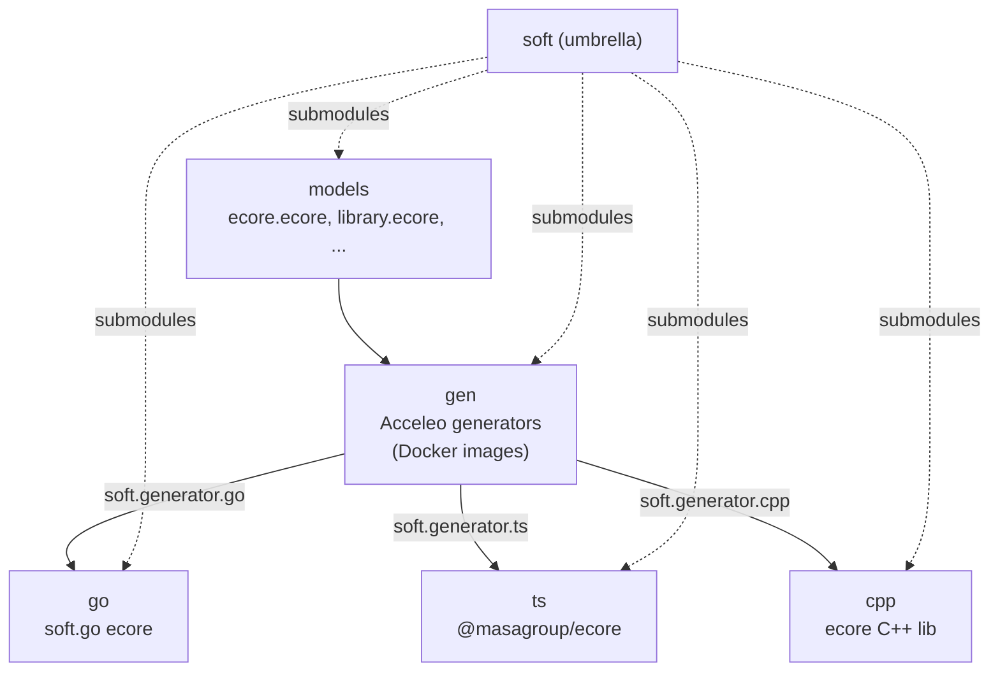
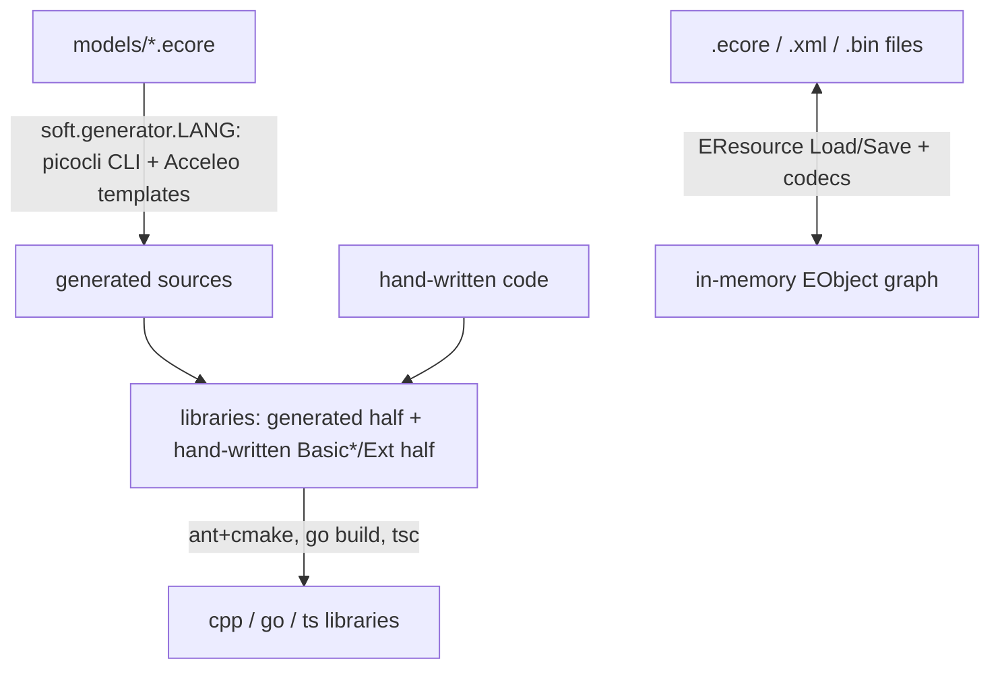
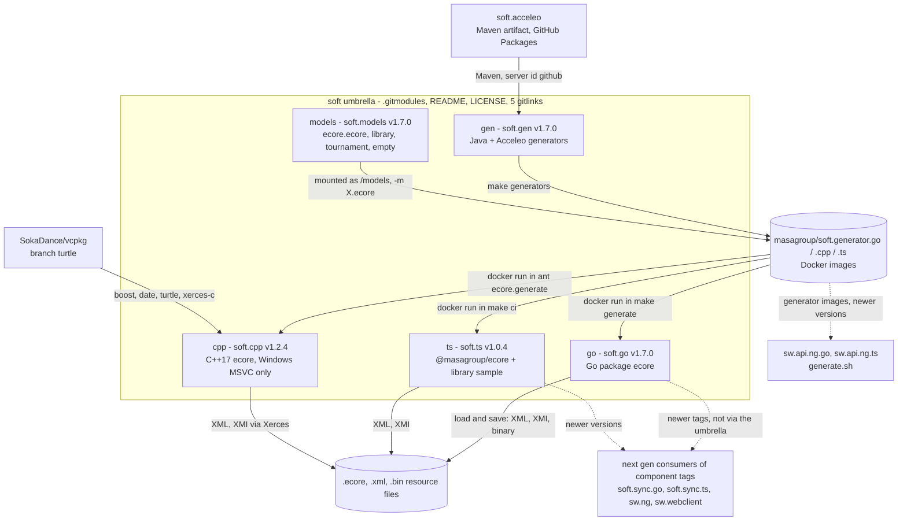
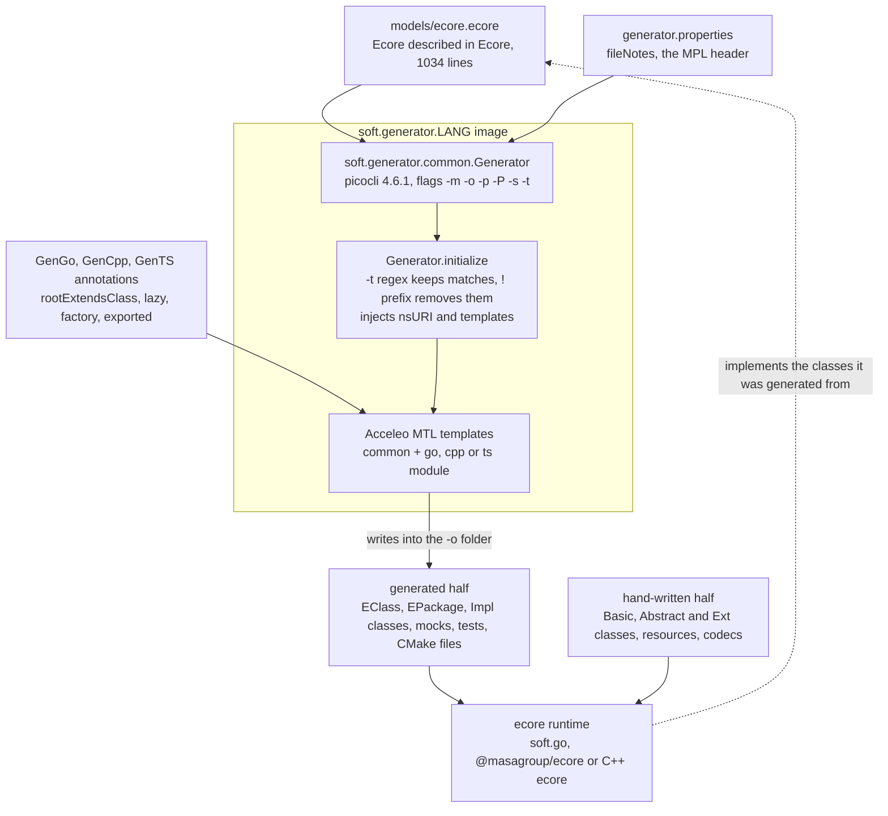
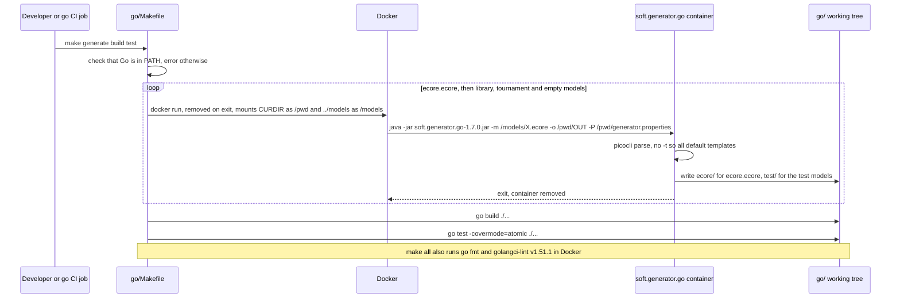
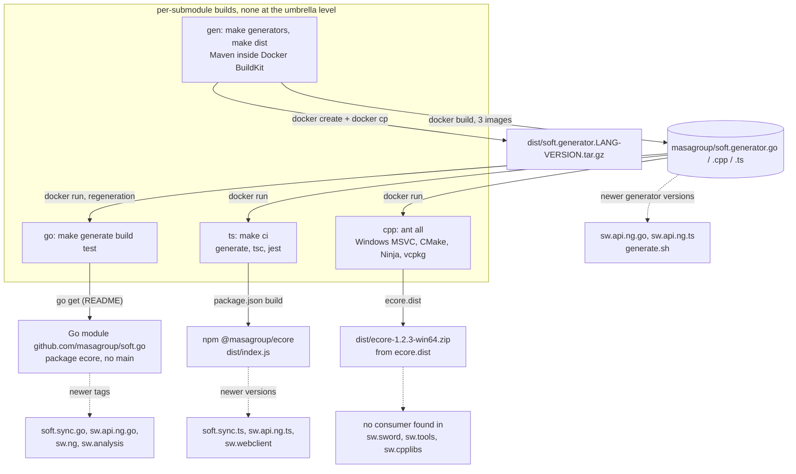

# soft: architecture

> Technical choices, diagrams and internal structure of `soft`. Back to the [README](README.md) · [Contributing](CONTRIBUTING.md) · [repository on GitHub](https://github.com/masagroup/soft)

| | |
|---|---|
| **Family** | Ecore / esync |
| **Kind** | build tooling (umbrella of git submodules: ecore model, C++ / Go / TypeScript libraries, generators) |
| **Languages** | Umbrella itself: none. Submodules: C++17 (`cpp`), Go (`go`), TypeScript (`ts`), Java + Acceleo MTL (`gen`), Ecore XMI models (`models`) |
| **Remote / branch** | github.com/masagroup/soft, default branch `master` |
| **Generation** | shared (foundation of the generated ecore model code; the umbrella itself is dormant, see Known issues) |
| **Build systems** | none at the umbrella level · per submodule: Make + Docker BuildKit (`gen`, `go`, `ts`) · Ant + CMake/Ninja (`cpp`, Windows/MSVC only) · Go · npm · Maven (inside the generator images) |

## Overview

The repository in its ecosystem (the text is in the [README](README.md#overview)):



## Position in the ecosystem

| Concept | Verdict | Evidence |
|---|---|---|
| ecore model | Implements: Ecore runtime in C++/Go/TS, Ecore XMI codecs, generators producing typed model code from `.ecore` | `go/ecore`, `ts/ecore/src`, `cpp/ecore/lib`, `gen/soft.generators`, `models/ecore.ecore` |
| esync (model synchronisation) | Not in this repo. Only building blocks exist (notifications, `EContentAdapter`, Go binary codec). Sibling working copies (`soft.sync.go`, which contains an `esync/` package and `cmd/{analyse,convert,feature-type,unbin}` with tags up to `v2.0.0-alpha.1`, plus `soft.sync.pb`, `soft.sync.pb.go`, `soft.sync.pb.ts`, `soft.sync.studio`, `soft.sync.ts`, and the `soft.acceleo` fork providing the Maven artifact used by `gen`) are not submodules of `soft` and were only listed, not scanned; see the ecosystem wiki page [esync and ecore](https://github.com/masagroup/wiki/wiki/esync-ecore) | repo-wide grep for `esync` found nothing |
| gateway, history, dos, storage, authentication, node, orchestrator, commander, hub, recorder, timeline, mapserver, webclient, datacore, dispatcher | Unrelated | no reference found |
| HLA | Unrelated | no reference |
| Consumers of generated model code | UNVERIFIED, likely: NG Go services and TS front-ends consume `soft.go/ecore` and `@masagroup/ecore`; the C++ simulation consumes the C++ ecore library | not provable from this repo |

Practical implications derived from the code:

- Language support is uneven: Go is the richest (binary codec, stores) and cross-platform; TypeScript supports XML/XMI only; C++ is Windows/MSVC only at the pin.
- For the Windows -> Linux port, `soft.cpp` is a blocker candidate: MSVC-only compile flags, Windows-only Ant bootstrap, no Dockerfile, no `packages-latest` image. The newer sibling `soft.cpp` is only 6 commits ahead and still carries an Ant `build.xml`, so a Linux path is not evident (UNVERIFIED in detail).
- Any NG repository that regenerates models depends on the Docker images `masagroup/soft.generator.*`; their supply chain therefore matters.
- Transverse context: the ecosystem wiki pages [Next-generation ecosystem](https://github.com/masagroup/wiki/wiki/ecosystem-nextgen), [esync and ecore](https://github.com/masagroup/wiki/wiki/esync-ecore) and [Glossary](https://github.com/masagroup/wiki/wiki/glossary).

## Repository layout

```
soft/
  .gitmodules  README.md  LICENSE
  gen/      Java + Acceleo MTL generators (soft.acceleo, soft.generators/{common,cpp,go,ts}), Makefile, Dockerfile-{base,go,cpp,ts}
  cpp/      C++17 ecore library: ecore/{lib,tests}, library/{lib,tests}, build.xml (Ant), build.properties, generator.properties
  go/       Go ecore library: ecore/ (package ecore), test/{empty,library,tournament}, Makefile, generator.properties
  ts/       TypeScript ecore library: ecore/ (@masagroup/ecore), library/ (sample + tests), Makefile
  models/   ecore.ecore (1034 lines, Ecore described in Ecore), library.ecore, tournament.ecore, empty.ecore, Eclipse launch configs
```

Tracked files in the umbrella (`git ls-tree HEAD`): `.gitmodules`, `LICENSE`, `README.md` and the five gitlinks.

## Architecture

### Generation concept and data flow



The libraries themselves do no network I/O; resource I/O goes through `EURIConverter` / `EURIHandler` (file; Go also `memory`).

The tracked tree contains both halves for Go only. In TypeScript the generated half is git-ignored (`ts/ecore/src/.gitignore` ignores `*Impl.ts`, `Ecore*.ts`, `E*.ts` except an allow-list of hand-written files; `ts/library/src/.gitignore` ignores all `*.ts` except `WriterExt*.ts` and tests), so `make ecore.generate` is required before `tsc`. In C++ only the hand-written half is tracked.

Annotations in the `.ecore` file steer each backend, for example `GenGo` `rootExtendsClass=ecore.CompactEObjectContainer`, `lazy=list:function`, `exported=true` on the Ecore package; `GenCpp` `factory=extension`.

### Core library API (consistent across the three languages)

- Object model: `EObject`, `EClass`, `EClassifier`, `EAttribute`, `EReference`, `EOperation`, `EPackage`, `EFactory`, `EEnum`, `EDataType`, `EAnnotation`, `EGenericType`; dynamic objects (`DynamicEObjectImpl`) and a reflective API.
- Collections: `EList`, `EMap`, `ENotifyingList`, `EObjectList`, `BasicEList`, `ImmutableEList`, `BasicEMap`, `BasicEObjectMap` (Go/TS), `ECollectionView` and `Lazy` (C++).
- Notifications: `ENotifier`, `ENotification`, `ENotificationChain`, `EAdapter` / `AbstractEAdapter`, `EContentAdapter` (change tracking over containment trees). No synchronisation code lives in this repository.
- Resources: `EResource`, `EResourceSet`, `EURIConverter`, `EURIHandler`, `EPackageRegistry`, codecs/factories, `EObjectIDManager` (Go: `UniqueIDManager`, `ULIDManager`, `UUIDManager`, `IncrementalIDManager`; TS: `UniqueIDManager`, `IncrementalIDManager`; C++: `ResourceIDManager`), `ExtendedMetaData`, `DeepCopy`, `DeepEqual`.
- Utilities: `EcoreUtils`, `EAllContents` / `ETreeIterator`.

### Per-language specifics

| Aspect | C++ (`cpp/ecore/lib/src/ecore`) | Go (`go/ecore`) | TypeScript (`ts/ecore/src`) |
|---|---|---|---|
| Serialization | XML (`XMLLoad/Save/Resource`), XMI (`XMILoad/Save/Resource`) via Xerces SAX (`SaxParserPool`) | XML, XMI, compact binary (msgpack-based, signature `\211emf\n\r\032\n`, versioned, option `BINARY_OPTION_ID_ATTRIBUTE`); JSON encoder only (`JSONCodec.NewDecoder` panics "not implemented", `go/ecore/jsoncodec.go`) | XML, XMI (SAX) only |
| Codec registration | `EResourceFactoryRegistry`, `XMLResourceFactory`, `XMIResourceFactory` | `EResourceCodecRegistry`: extension `ecore` -> `XMICodec`, `xml` -> `XMLCodec`, `bin` -> `BinaryCodec`; protocol `memory` -> `NoCodec` (`go/ecore/eresourcecodecregistry.go:25-33`) | `EResourceFactory`, `XMLResourceFactory`, `XMIResourceFactory` |
| Memory model | smart pointers (`SmartPtr.hpp`), proxies, `BasicEObject` | `CompactEObjectImpl` / `CompactEObjectContainer` (compact feature storage), `EStore` + `EStoreEObject` (pluggable feature store, `estore.go`) | `BasicEObject`, `AbstractEObject` |
| Mocks | Turtle (`ecore/tests/src-gen/ecore/tests/MockEObject.hpp`) | mockery-style `*_mock.go` (50 files) plus generated mock tests | ts-mockito |
| Tests | Boost.Test + ctest | `go test` + testify; fixtures in `go/ecore/testdata` (xml, bin, ecore) | jest + ts-jest; fixtures in `ts/ecore/testdata` |
| Platforms | Windows MSVC only | cross-platform | Node |

### Notable patterns

- Code generation drives the library itself; the tree mixes `*Impl`, `*_mock` and `*_ext` (hand-written extension hooks).
- Generators are distributed as self-contained Docker images (trimmed `jlink` JRE on Alpine); no JDK or Eclipse is needed on build machines.
- Go offers pluggable ID managers (incremental, ULID, UUID) and a versioned binary format. Whether a SWORD component depends on these properties (determinism, compatibility) is UNVERIFIED.

## How it works

soft ("Sword Object Facilities") is an umbrella repository that tracks only `.gitmodules`, `README.md`, `LICENSE` and five gitlinks: `gen` (soft.gen at its v1.7.0 pin, the Java + Acceleo code generators; soft.gen itself has since replaced them with Go `text/template` generators, one `soft.gen` command, and keeps v1 in its history), `go`, `ts` and `cpp` (MASA's own Ecore runtimes in Go, TypeScript and C++17: soft.go, soft.ts, soft.cpp) and `models` (soft.models, the `.ecore` metamodels that bootstrap them). Nothing runs at the umbrella level and no port is opened: the only executables are the three generators, command-line tools packaged as the Docker images `masagroup/soft.generator.{go,cpp,ts}` that take an `.ecore` file plus options and write typed source code, and the test executables. The libraries load and save `.ecore`, `.xml` and `.bin` resources into an in-memory EObject graph and do no network I/O. It is shared foundation code (the start of the ecore model generation chain used by the next gen services), but the umbrella itself is dormant: its pins (gen and go v1.7.0, ts v1.0.4, cpp v1.2.4, models v1.7.0, last bump 2023-05-23) are 723 (soft.go), 313 (soft.gen) and 339 (soft.ts) commits behind the component repositories, which are the source of truth.

### Components and data flow



- The umbrella builds nothing: `git clone --recurse-submodules` (or `git submodule update --init`) checks the five submodules out at their pinned commits, in detached HEAD. Its layout (`soft/go`, `soft/ts`, `soft/cpp` next to `soft/models`) satisfies the sibling requirement of the libraries' builds (`$(realpath ../models)` in the go and ts Makefiles, `../models` in `cpp/build.xml`).
- Build order: `gen` first, whose `make generators` builds the three generator images with Maven inside Docker BuildKit; Maven resolves the patched Acceleo URI handler `soft.acceleo:soft.acceleo:1.0.0` from GitHub Packages (server id `github`, credentials in `gen/settings.xml`; an in-tree copy `gen/soft.acceleo/` is installed first). Then `go`, `ts` and `cpp` each run their generator image with `docker run` on `models/*.ecore` to regenerate part of their own sources, then their tests.
- `cpp` additionally bootstraps aria2 1.34.0, CMake 3.18.0 and Ninja 1.8.2 (SHA-512 checked) and the SokaDance/vcpkg `turtle` fork, which installs `boost-test boost-regex date turtle xerces-c` for the triplet `x64-windows`.
- At runtime the libraries convert between files and the EObject graph through `EResource` load and save, codecs and `EURIConverter` / `EURIHandler` (file handler, Go also `memory`). Go registers `ecore` -> XMI, `xml` -> XML, `bin` -> a versioned msgpack-based binary codec (its JSON codec only encodes); TypeScript and C++ support XML and XMI only. No esync (synchronisation) code lives here, only its building blocks: notifications, `EContentAdapter`, the Go binary codec.
- The pinned `gen` is the v1 line. In the soft.gen repository itself the v1 tree (Maven, Acceleo, `Dockerfile-<lang>`) is removed from master: it holds Go `text/template` generators with one command `soft.gen` (subcommands `go` and `ts`, C++ not ported yet) and the image `masagroup/soft.gen`, while the v1 images `masagroup/soft.generator.{cpp,go,ts}` remain for v1. The Makefiles of the newer soft.go and soft.ts already run soft.gen v2 (`go run`), whereas the pinned `go/`, `ts/` and `cpp/` still run the v1 images.
- Consumers are not visible from this repository (UNVERIFIED in the wiki page). The transverse analysis lists the umbrella as consumed by nobody (historical), although the soft.ts and soft.sync.studio pages say that soft.sync.studio links the `ts` submodule checkout of the umbrella by `file:../../soft/ts/ecore` and shows next gen repositories consuming the component repositories directly at much newer versions (sw.ng pins soft.go v1.10.2, sw.webclient `@masagroup/ecore` 1.5.8), the generator images being used by the `generate.sh` scripts of sw.api.ng.go and sw.api.ng.ts. No consumer of soft.cpp was found in sw.sword, sw.tools or sw.cpplibs.

### Inside the generation chain



- Bootstrapping: `models/ecore.ecore` is the input of each generator, which emits the generated half of the Ecore library itself (interfaces and implementations of `EClass`, `EPackage`, `EAttribute`, ... and mocks), while the hand-written half (`Basic*`, `Abstract*`, `*Ext`, resources, codecs) lives in each library. `library.ecore`, `tournament.ecore` and `empty.ecore` are test models generated the same way.
- The CLI is identical for the three generators: `-m` input model and `-o` output folder (both required), `-p key=value` and `-P file` (repeatable properties), `-s` (print only failures), `-t` (regex template selection, `!` excludes), `-v` (version from the jar manifest). `nsURI` and `templates` are injected automatically; `generator.properties` in `cpp/`, `go/` and `ts/` only defines `fileNotes`.
- Default templates: Go `generateModel, generateTests, generateMocks, generateMocksTests` (NS URI `http://net.masagroup/soft/2019/GenGo`); C++ `generateModel`, `generateTests` and five library and tests CMake templates (`.../2018/GenCpp`), with `cpp/build.xml` excluding `generateLibraryCMakeProject` and `generateTestsCMakeProject`; TypeScript `generateModel, generateModule, generateTests` (`.../2020/GenTS`), with the ecore call of `ts/Makefile` excluding `generateModule`.
- Annotations in the `.ecore` steer each backend, for example GenGo `rootExtendsClass=ecore.CompactEObjectContainer`, `lazy=list:function`, `exported=true` on the Ecore package, GenCpp `factory=extension`. The transverse analysis shows the same mechanism (properties `packages` and `rootExtendsClass`) tying the generated SWORD classes of sw.api.ng.go and sw.api.ng.ts to esync.
- What is committed differs per language: Go commits both halves of the `ecore` package (output under `go/test/*` is git-ignored, so those tests compile only after `make generate`); in TypeScript the generated half is git-ignored, so `make ecore.generate` must run before `tsc`; in C++ only the hand-written half is tracked (`ecore/lib/src-gen/ecore/` holds only `EObject.hpp`). A template change therefore ripples soft.gen -> runtimes -> sw.api.ng.* -> consumers.

### Startup and runtime



- The only executables are the generators; a typical run is the regeneration step of a library build. `make generate build test`, run from `go/`, is exactly what the go GitHub workflow runs (Go 1.20.x, soft.models checked out as a sibling at `a6b7a0c1`). Prerequisites: Go in PATH, Docker, the image `masagroup/soft.generator.go` (pulled from Docker Hub or built from `gen`) and a sibling `../models`.
- Each generator run is a short-lived container: no port, no handshake, no environment variable; input and output go through the mounted volumes. The image entrypoint is a trimmed `jlink` JRE on Alpine running `java -jar /usr/share/soft.generator.<lang>/soft.generator.<lang>-<ver>.jar`, so no JDK or Eclipse is needed on build machines.
- The same pattern drives the other libraries: `ts/` `make ci` (generation, `tsc`, `jest`; the ts workflow runs `sudo make ci` with Node 17.2.0 and soft.models at `f487e7c8`, not the umbrella pin), and `cpp/` `ant` (in an MSVC-initialised shell), whose `ecore.generate` runs `masagroup/soft.generator.cpp` before CMake configure, build, ctest, install, cpack and zip.
- Outside builds, the generators can be run by hand (`docker run --rm -v "$PWD":/gen -w /gen masagroup/soft.generator.go -s -m /gen/model.ecore -o /gen`, from the gen README) or from Eclipse through the seven `generate.*.launch` configurations of soft.models.

### From sources to artifacts



- gen: `make` (= `generators tests`, each image must report the version declared in `gen/Makefile`) runs three Docker stages per language: `build` (`maven:3.8.1-openjdk-16-slim`, `mvn` on `soft.acceleo` then `soft.generators`), `jvm` (`openjdk:16-alpine`, `jdeps` + `jlink`) and a final `alpine` image. `make dist` exports `dist/soft.generator.<lang>-<version>.tar.gz`; `make publish` pushes the images and is never run in our setup.
- Libraries: soft.go is a Go package with no `cmd/` or `main`; soft.ts produces the npm package `@masagroup/ecore` 1.0.4 (plus the sample package `library`, which depends on it through `file:../ecore`); soft.cpp produces the shared library `ecore` (`ecore-vc<toolset>-mt[-gd]`), the static `ecore.static`, the test binary `ecore.tests` and `dist/ecore-1.2.3-win64.zip` (`ecore.version=1.2.3` while the pinned tag is v1.2.4). soft.cpp has no Dockerfile and no `packages-latest` image, which makes it a blocker candidate for the Windows -> Linux port.
- CI: the gen, go and ts workflows only build and test (old-style `actions/checkout@v2`, `setup-go@v2`, `setup-node@v2`, no `masagroup/cicd` reusable workflow, no artifact); cpp and models have no workflow and the umbrella has no `.github/`. How the Docker Hub images, the npm package, the Go tags and the GitHub release assets are actually published is UNVERIFIED.
- The umbrella itself produces no artifact; next gen repositories should depend on component tags, not on this umbrella (wiki page, Open questions).

## Dependencies

### Internal (MASA repositories)

| Repository | How it is pulled | What for |
|---|---|---|
| [soft.gen](https://github.com/masagroup/soft.gen) | `.gitmodules` (submodule `gen`) | aggregation; Acceleo generators |
| [soft.cpp](https://github.com/masagroup/soft.cpp) | `.gitmodules` (submodule `cpp`) | aggregation; C++ ecore library |
| [soft.go](https://github.com/masagroup/soft.go) | `.gitmodules` (submodule `go`) | aggregation; Go ecore library |
| [soft.ts](https://github.com/masagroup/soft.ts) | `.gitmodules` (submodule `ts`) | aggregation; TypeScript ecore library |
| [soft.models](https://github.com/masagroup/soft.models) | `.gitmodules` (submodule `models`); `-v ../models:/models` in `go`/`ts`/`cpp` builds; explicit checkout in go and ts CI | source `.ecore` files (`ecore.ecore`, `library.ecore`, `tournament.ecore`, `empty.ecore`) |
| `masagroup/soft.generator.{go,ts,cpp}` Docker images (built from `gen`) | `docker run` in `go/Makefile`, `ts/Makefile`, `cpp/build.xml` | regenerate model-derived sources |
| `masagroup/soft.acceleo` (Maven `soft.acceleo:soft.acceleo:1.0.0`, registry `https://maven.pkg.github.com/masagroup/soft.acceleo`) and an in-tree copy `gen/soft.acceleo/` | `gen/soft.generators/pom.xml` (profile `docker`), `Dockerfile-base` | patched Acceleo URI handler so templates resolve from a jar/classpath |
| `SokaDance/vcpkg` branch `turtle` | `cpp/build.xml` target `vcpkg.install` | vcpkg fork providing the `turtle` mocking port |

CI pins of `soft.models`: go CI checks out `masagroup/soft.models@a6b7a0c1` (same as the umbrella pin); ts CI checks out `masagroup/soft.models@f487e7c8` (differs from the umbrella pin).

Not present: any use of [sw.poney](https://github.com/masagroup/sw.poney), the `<update>` / `<update-gh>` Ant macros, `FROM masagroup/*` lines, `require github.com/masagroup/*` in `go.mod` (the Go module has no MASA dependency), and any `@masagroup/*` npm dependency except `library` -> `@masagroup/ecore` (`file:../ecore`). The cpp Ant file is self-contained.

Reverse dependencies (who consumes SOFT) are not visible from this repository: UNVERIFIED (see Open questions).

### External

| Component | Dependency | Version | Use |
|---|---|---|---|
| go | `github.com/vmihailenco/msgpack/v5` | v5.3.5 | binary codec (`binaryencoder.go`, `binarydecoder.go`) |
| go | `github.com/oklog/ulid/v2` | v2.1.0 | `ULIDManager` (`uniqueidmanager.go`) |
| go | `github.com/karlseguin/jsonwriter` | v1.0.4 (2017 pseudo-version) | JSON encoder (`jsonencoder.go`) |
| go | `github.com/OneOfOne/go-utils` | 2018 pseudo-version | helper |
| go | `golang.org/x/net` | v0.9.0 | `html/charset` for XML decoding, `html` for escaping |
| go | `github.com/stretchr/testify` | v1.8.2 | tests and generated mocks |
| go tooling | golangci-lint Docker image | v1.51.1 | lint |
| ts | `sax` ^1.2.4, `@types/sax` ^1.2.1, `@types/uuid` ^8.3.0 | | XML parsing |
| ts dev | `typescript` ^4.2.3, `jest` ^26.6.3, `ts-jest` ^26.5.4, `ts-mockito` ^2.6.1, `prettier` ^2.2.1, `deep-equal` ^2.0.5 | | build/test; `tsconfig` target `es2017`, `module commonjs` |
| ts CI | Node 17.2.0 | | `actions/setup-node@v2` |
| cpp | Xerces-C, Boost.Regex, `date` (Howard Hinnant), Threads; tests: Boost.Test, Turtle | from the vcpkg fork, not pinned in this repo | XML parsing, regex, dates |
| cpp tools | aria2 1.34.0, CMake 3.18.0, Ninja 1.8.2 | pinned by URL + SHA-512 | bootstrap in `build.xml` |
| cpp | MSVC (VS2019 generator by default; VS2015/2017 supported), C++17 | | the `/MP /bigobj /wd4250` options make the CMake files MSVC-specific |
| gen | Acceleo `3.7.11-SNAPSHOT` (+ maven plugin 3.6.4), EMF ecore 2.21.0, ecore.xmi 2.16.0, emf.common 2.18.0, OCL 3.4.2, Guava 30.0-jre, picocli 4.6.1, Eclipse core/equinox libraries (2014 builds) | | generator engine |
| gen | Java 1.8 source/target; images `maven:3.8.1-openjdk-16-slim`, `openjdk:16-alpine`, `alpine`; `edrevo/dockerfile-plus`; `klakegg/saxon` (version stamping) | | image build |

Several toolchain versions are old at the pin (Acceleo SNAPSHOT builds, OpenJDK 16, Node 17, Jest 26, Go 1.20, golangci-lint 1.51), which matters for reproducibility.
